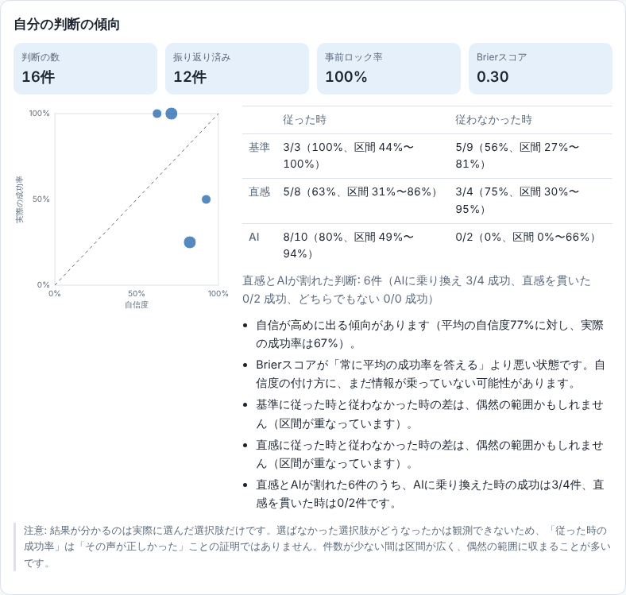
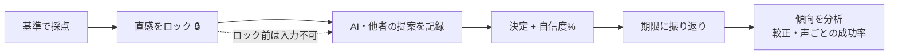
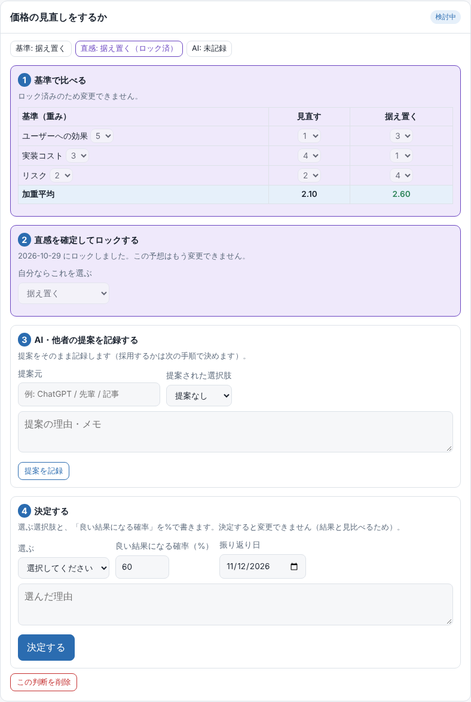

# 判断ログ（Decision Journal）

**AIに聞く前に、自分の基準と直感を確定する。後で結果を振り返り、自分の判断の精度と、AIの使い方を測る。**

AIに相談すれば、それらしい答えはすぐ返ってきます。けれど「提案を見てから考える」ことを続けると、自分の判断軸が育たず、AIの答えが良かったのか悪かったのかも分からないままになります。判断ログは、その問題を小さな仕組みで解きます。ブラウザだけで動き、データは端末の外に出ません。



## 何が違うのか
一般的なメモアプリや意思決定ツールは「選択肢を整理する」ところまでです。判断ログは **決める前後の順序を固定し、結果から学ぶところ** までを扱います。

1. **基準で比べる** … 判断基準に重みを付け、選択肢を採点（加重平均）
2. **直感をロックする** … 自分ならどれを選ぶかを決めて **ロック**。以後、基準と直感は変更できません
3. **AI・他者の提案を記録する** … **ロックするまで入力できません**。提案に引きずられる前に、自分の考えを固めるための仕掛けです
4. **決定する** … 選択と「良い結果になる確率（%）」を記録。決定後は変更不可
5. **振り返る** … 期限の日に結果（良い／良くない）と学びを記録



ロックした封印済みの判断は、こう見えます（AIの提案欄はロックするまで入力できません）。



結果が貯まるほど、次のことが分かります。

| 見えること | 中身 |
|---|---|
| 自信度の合い具合 | 「80%の自信」の時に、実際に何%うまくいったか（較正グラフ、Brierスコア） |
| 3つの声の使い分け | **基準／直感／AI** それぞれに従った時と従わなかった時の成功率（95%ウィルソン区間つき） |
| 割れた時の選択 | 直感とAIが違った判断で、AIに乗り換えた／直感を貫いた時の成否 |
| 事前ロック率 | AIに聞く前に自分の考えを固められた割合 |

## 数字の読み方（誠実さのために）
- **反事実は観測できません。** 結果が分かるのは実際に選んだ選択肢だけです。「AIに従った時の成功率が高い」は「AIが正しかった」ことの証明ではありません。画面にも同じ注意を表示しています。
- **件数が少ないうちは断定しません。** 成功率は割合だけでなく95%ウィルソン区間を併記し、区間が重なる時は「偶然の範囲かもしれません」と表示します。振り返りが5件未満の間は「参考程度」と明示します。
- **Brierスコア** は `平均((自信度 − 結果)²)`（0〜1、小さいほど良い）。「常に平均の成功率を答える」場合より悪い時は、自信度の付け方に情報が乗っていないと注意します。

## プライバシーとセキュリティ
詳細は [SECURITY.md](SECURITY.md)。要点だけ：
- データは **localStorage のみ**。サーバー・アカウント・外部通信なし（CSPで外部接続を禁止）
- 書き出しは **暗号化に対応**: AES-256-GCM、鍵はパスフレーズから PBKDF2-SHA256（60万回）で導出。ブラウザ標準の Web Crypto のみで、外部ライブラリなし。パスフレーズは保存しません
- 描画は `textContent` / `createElement` のみ。`innerHTML` を使わない（XSS対策）
- 保存データ・読み込むJSON・復号結果は、すべて同じ検証関数（`sanitize`）を通します
- リポジトリのサンプルは **すべて架空**。個人情報は含みません

## 使い方
1. `index.html` をブラウザで開く
2. 「架空のサンプルを読み込む」で、傾向の見え方を確認
3. 「新しい判断を始める」に、決めたいこと・選択肢（1行に1つ）・基準（1行に1つ、末尾に重み1〜5）を入力
4. 基準を採点 → 直感をロック → AIの提案を記録 → 決定 → 期限に振り返り

GitHub Pages で公開する場合は、Settings → Pages で `main` を選ぶだけです。

## 設計メモ
```
index.html   画面（CSPを meta で宣言）
stats.js     分析ロジック。画面・保存に依存しない純粋関数（加重スコア、ウィルソン区間、較正、声ごとの成功率）
store.js     保存と検証（sanitize）、判断の作成
crypto.js    暗号化書き出し（AES-GCM + PBKDF2）
app.js       画面の描画とイベント処理
tests/       自動テスト（分析・検証・暗号化・画面・セキュリティ）
```
- **順序を仕組みで守る**: 「先に自分の考えを固める」を、意志ではなく画面の制約（ロックと入力の無効化）で実現しています
- **ロジックと画面の分離**: 分析は純粋関数なので、日付や結果を固定して検証できます
- **同点は結論を出さない**: 基準の加重平均が同点なら「同点」とし、無理に1つを選びません
- **暗号化の入口で検査**: 読み込んだ暗号化ファイルは、反復回数の範囲（10万〜200万）・salt/ivの長さ・形式を計算前に検査し、悪意あるファイルで画面が固まらないようにしています。復号失敗は、パスフレーズ違いと改ざんを区別しません
- **ES module を使わない理由**: `index.html` をダブルクリックして開けるようにするため

詳しい数式と設計判断は [docs/DESIGN.md](docs/DESIGN.md)。

## 今後の拡張案
- 判断のテンプレート（技術選定、購入、進路など）と、振り返りの通知
- 基準の再利用（過去の判断から基準をコピー）
- 結果を良い／悪いの2値ではなく、満足度の段階で測る

## 開発
```
npm install
npm test     # Node 20 以上。分析・検証・暗号化・画面(jsdom)・セキュリティの自動テスト
```

## ライセンス
MIT
